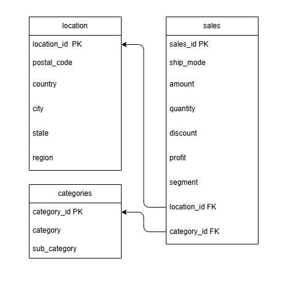

# store-etl
ETL-пайплайн: CSV > pandas > SQLite > проверки > отчёты

## Стек
Python, pandas, SQLite

## Запуск
```
pip install pandas
python main.py
```

## Датасет
Superstore (Kaggle), https://www.kaggle.com/datasets/roopacalistus/superstore

## Схема данных



## Особенности данных
- Пропущенных значений в датасете не обнаружено 
- Отрицательная прибыль сохранена, так как отражает реальные убытки